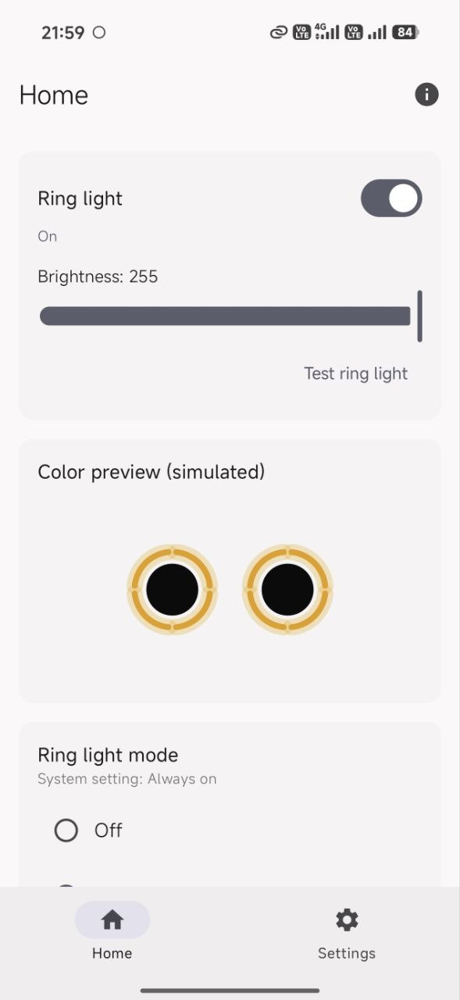
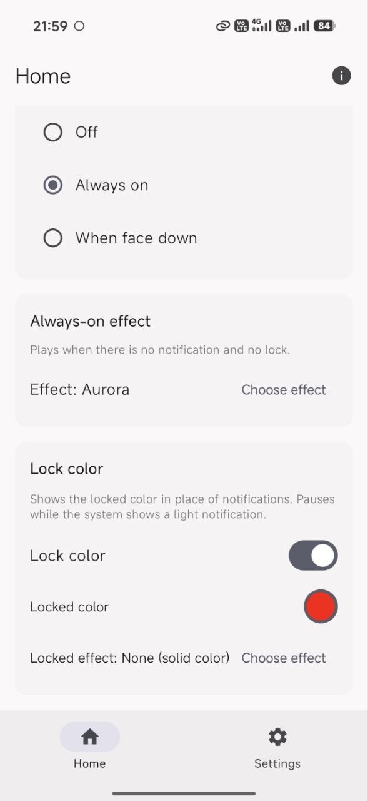
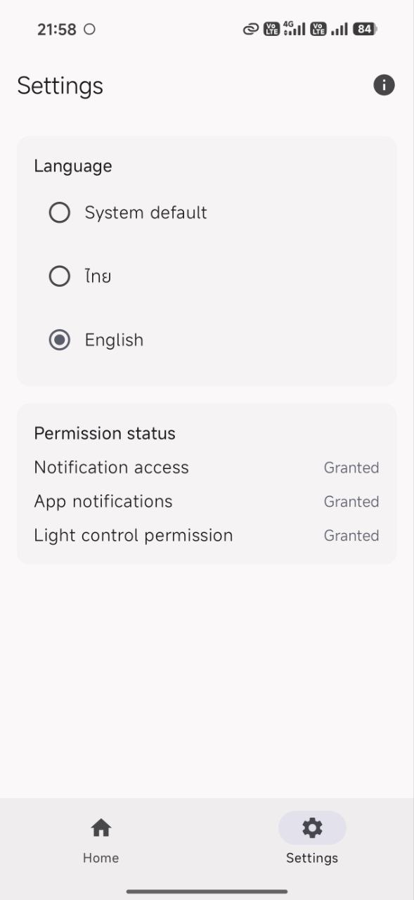

# Always-On Ring

[ภาษาไทย](README.th.md)

Control the HyperOS camera-ring LED from a normal (non-root) app: ambient effects, color lock, and notification-aware yield to system lights.

**Requires a HyperOS device with an RGB ring** (e.g. POCO x8 PRO / similar). Not a generic AOSP LED app.

## Screenshots

| Home | Effects & lock | Settings |
|:---:|:---:|:---:|
|  |  |  |

## Features

- **Ambient always-on effects** — animated patterns while idle (rainbow, breathe, aurora, scan, heartbeat, …)
- **Lock color** — hold a solid color or effect above notifications until unlocked
- **System yield** — pauses app paint when the OS owns the ring (notification light, music light); resumes cleanly
- **Ring mode** — off / always / face-down
- **Brightness** + live simulated ring preview
- **Thai / English** UI
- Optional **Shizuku** path for `WRITE_SECURE_SETTINGS`; ADB grant also supported

## Permissions

| Permission | Why |
|---|---|
| Notification listener | React to / yield for notification lights |
| `POST_NOTIFICATIONS` | Foreground service status |
| `WRITE_SECURE_SETTINGS` | Ring mode + suppress competing system painters |

```bash
adb shell pm grant com.x8rgb android.permission.WRITE_SECURE_SETTINGS
```

## Build

```bash
git clone https://github.com/tew080/x8rgb.git
cd x8rgb
./gradlew :app:assembleDebug
```

- minSdk 34 · target/compileSdk 36  
- Kotlin · Jetpack Compose · Hilt · Room  

## Architecture

```
NotificationListener ──► SystemLightArbiter (holds)
        │                        │
        ▼                        ▼
ForegroundService ◄── yield/resume ── EffectEngine → MiuiLightsBinder
        │
   Settings / RingSwitch / SystemLightGuard
```

## License

[GPL-3.0](LICENSE) — see `LICENSE` in this repository.

## Credits

- **Developer:** [tew080](https://github.com/tew080)
- **Repository:** [github.com/tew080/x8rgb](https://github.com/tew080/x8rgb)

Unofficial. Uses undocumented HyperOS APIs. May break after system updates. Use at your own risk.
