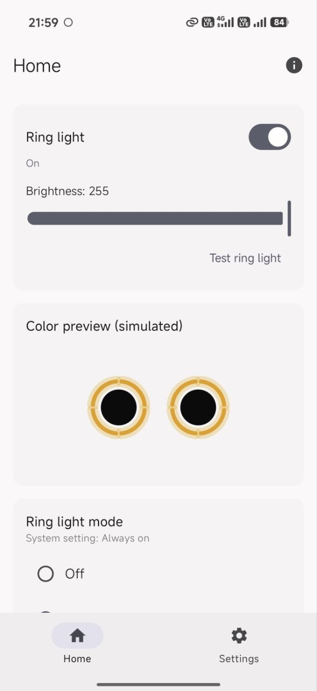
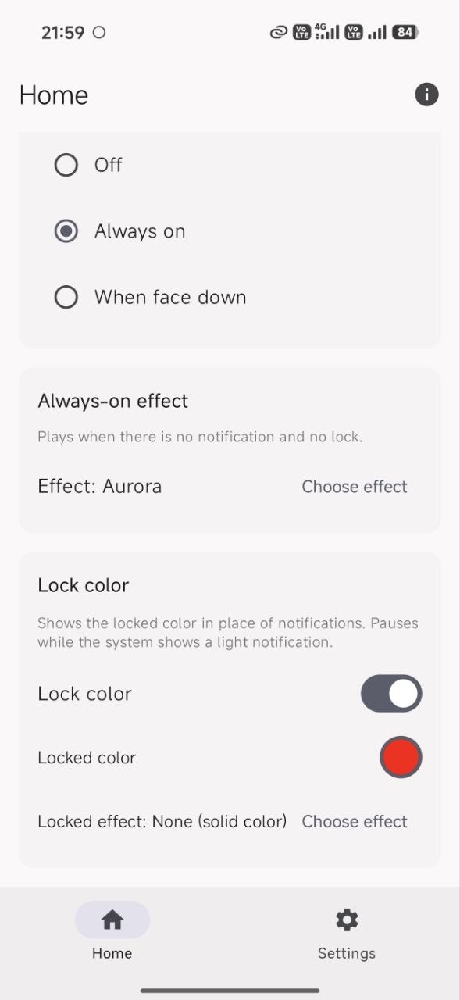
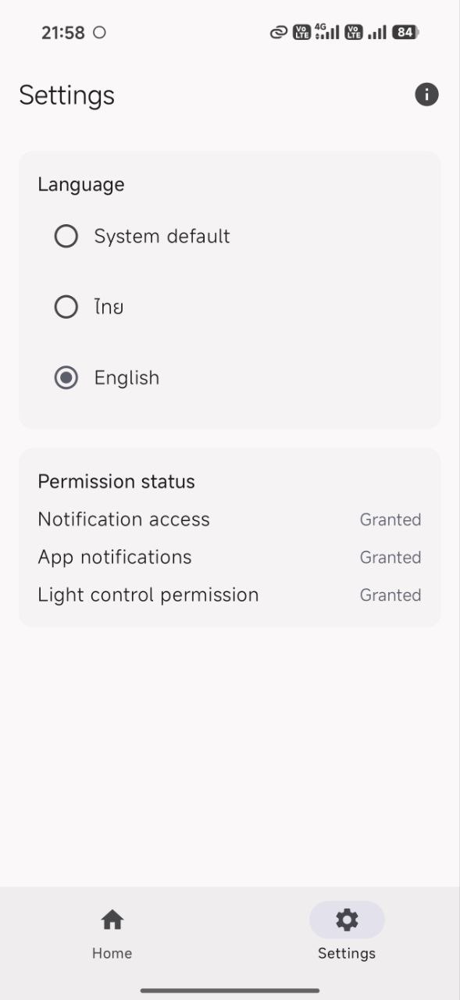

# Always-On Ring

[English](README.md)

ควบคุมไฟวงแหวนรอบกล้องบน HyperOS จากแอปธรรมดา (ไม่ต้องรูท): เอฟเฟกต์พื้นหลัง ล็อกสี และยอมให้ระบบใช้ไฟเมื่อมีการแจ้งเตือน/เพลง

**ต้องใช้อุปกรณ์ HyperOS ที่มีไฟวงแหวน RGB** (เช่น POCO x8 PRO หรือรุ่นใกล้เคียง) ไม่ใช่แอป LED ทั่วไปของ AOSP

## ภาพหน้าจอ

| หน้าหลัก | เอฟเฟกต์และล็อกสี | ตั้งค่า |
|:---:|:---:|:---:|
|  |  |  |

## ฟีเจอร์

- **เอฟเฟกต์ตลอดเวลา** — รูปแบบเคลื่อนไหวเมื่อไม่มีแจ้งเตือน (สายรุ้ง หายใจ ออโรรา สแกน หัวใจเต้น ฯลฯ)
- **ล็อกสี** — ค้างสีหรือเอฟเฟกต์ทับการแจ้งเตือนจนกว่าจะปิดล็อก
- **ยอมให้ระบบ** — หยุดวาดเมื่อระบบใช้วงแหวน (ไฟแจ้งเตือน ไฟเพลง) แล้วกลับมาต่อเอง
- **โหมดไฟ** — ปิด / เปิดตลอด / เปิดเมื่อคว่ำจอ
- **ความสว่าง** + ตัวอย่างวงแหวนจำลองแบบเรียลไทม์
- **ภาษาไทย / อังกฤษ**
- ทางเลือก **Shizuku** สำหรับ `WRITE_SECURE_SETTINGS` หรือให้สิทธิ์ผ่าน ADB

## สิทธิ์ที่ต้องใช้

| สิทธิ์ | เหตุผล |
|---|---|
| การเข้าถึงการแจ้งเตือน | ตอบสนอง / ยอมให้ระบบเมื่อมีไฟแจ้งเตือน |
| `POST_NOTIFICATIONS` | การแจ้งเตือนของบริการเบื้องหน้า |
| `WRITE_SECURE_SETTINGS` | โหมดไฟ + ปิดแหล่งไฟของระบบที่แข่งกัน |

```bash
adb shell pm grant com.x8rgb android.permission.WRITE_SECURE_SETTINGS
```

## วิธีบิลด์

```bash
git clone https://github.com/tew080/x8rgb.git
cd x8rgb
./gradlew :app:assembleDebug
```

- minSdk 34 · target/compileSdk 36  
- Kotlin · Jetpack Compose · Hilt · Room  

## หมายเหตุการติดตั้ง (Play Protect)

ถ้าติดตั้ง APK ไม่ได้เพราะ Play Protect เตือน ให้เปิด **Play Store → โปรไฟล์ → Play Protect → การตั้งค่า** แล้วปิด **สแกนแอปด้วย Play Protect** ชั่วคราว ติดตั้งให้เสร็จ แล้วเปิดกลับ

## สถาปัตยกรรมโดยย่อ

```
NotificationListener ──► SystemLightArbiter (holds)
        │                        │
        ▼                        ▼
ForegroundService ◄── yield/resume ── EffectEngine → MiuiLightsBinder
        │
   Settings / RingSwitch / SystemLightGuard
```

## สัญญาอนุญาต

[GPL-3.0](LICENSE) — ดูไฟล์ `LICENSE` ในรีโพ

## เครดิต

- **นักพัฒนา:** [tew080](https://github.com/tew080)
- **ซอร์สโค้ด:** [github.com/tew080/x8rgb](https://github.com/tew080/x8rgb)

ไม่เป็นทางการ ใช้ API ของ HyperOS ที่ไม่ได้เปิดเผย อาจใช้ไม่ได้หลังอัปเดตระบบ ใช้ด้วยความรับผิดชอบของตนเอง
